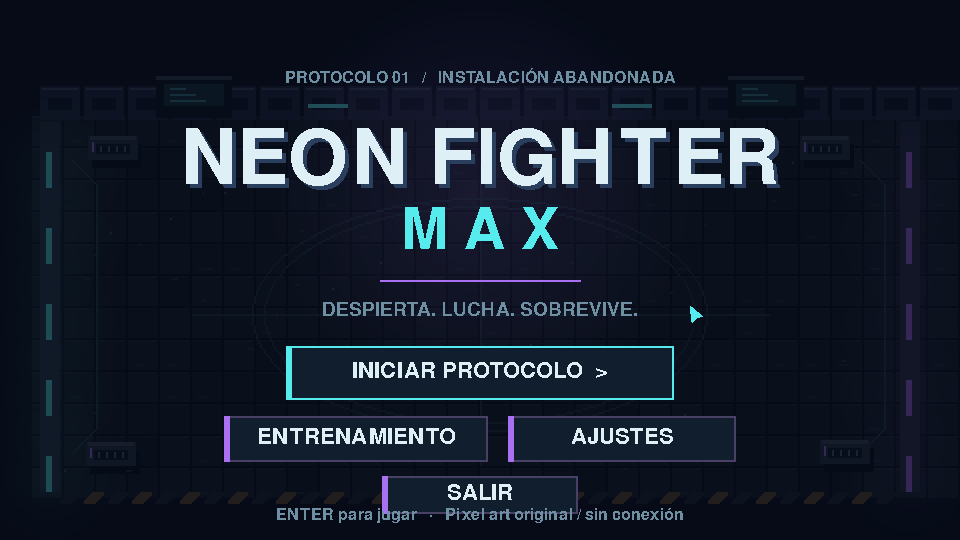
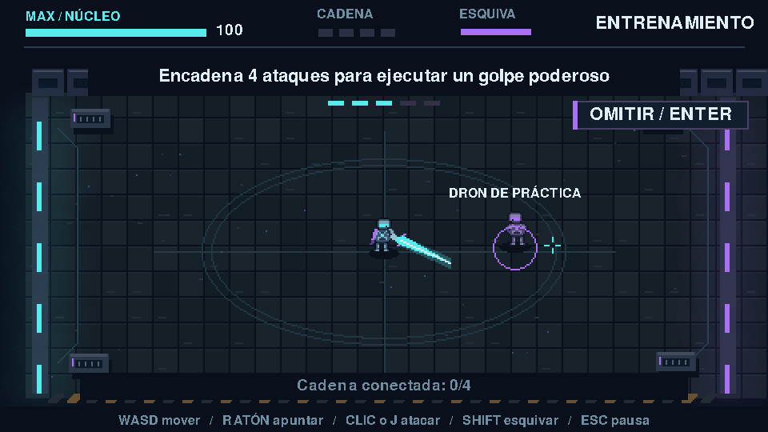
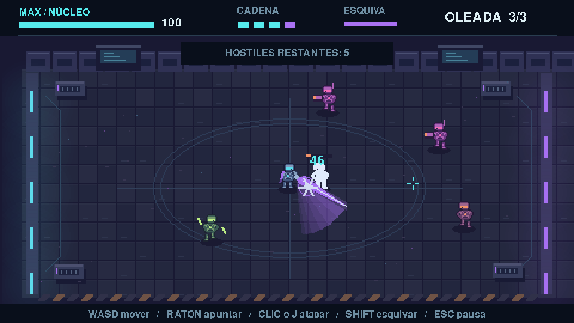
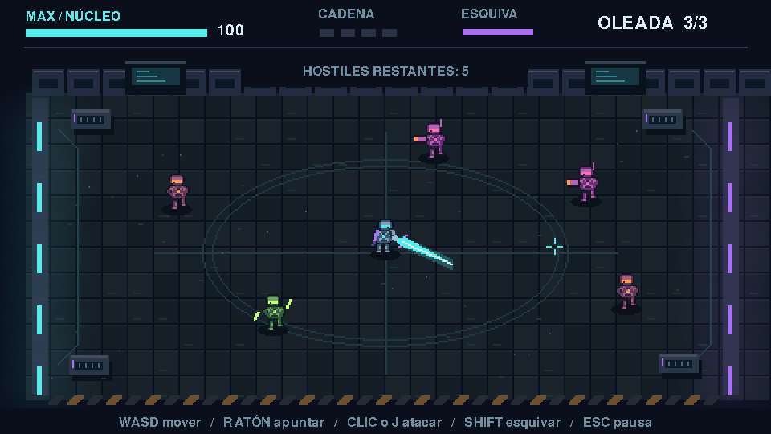
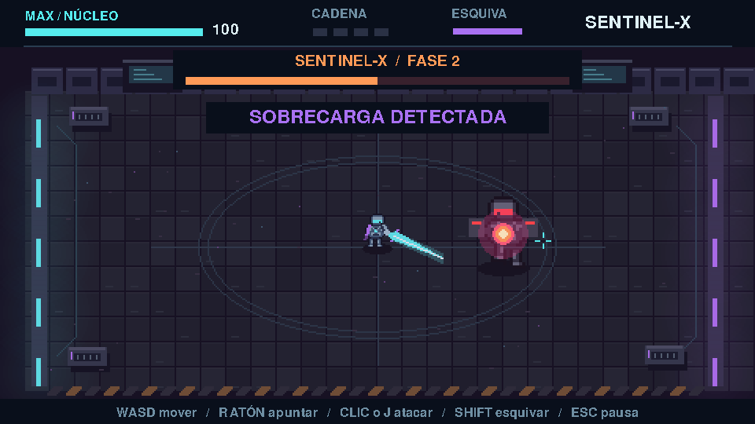

# Neon Fighter Max

Neon Fighter Max es un minijuego de acción 2D desarrollado con Python y pygame-ce. El jugador controla un androide con una espada de energía dentro de una instalación tecnológica abandonada. La presentación combina pixel art, iluminación ambiental y efectos neón.

**Estudiante:** Max Gabriel Sánchez Flores.

**Coach:** Ronald Mejía

Para esta actividad desarrollé **Neon Fighter Max**, un juego de combate con vista superior y estética pixel art de ciencia ficción. El personaje principal es un robot que utiliza una espada de energía para enfrentarse a enemigos dentro de una instalación tecnológica abandonada.

Mi idea era crear un juego pequeño que pudiera ejecutarse sin demasiados requisitos, pero que tuviera una presentación visual agradable y un combate interesante. Por eso me enfoqué en el movimiento del personaje, la espada, los combos, las oleadas de enemigos y el enfrentamiento contra Sentinel-X que es el boos del juego. Durante el desarrollo fui ajustando las características según los resultados de las pruebas.

**Tecnologías:** Python 3.12, pygame-ce, Visual Studio Code y extensión Codex, con el modelo GPT-6.1 Sol en esfuerzo medio. Utilicé Git y GitHub para organizar los cambios y realizar personalmente los commits.

## Descripción y funcionamiento resumido del videojuego

El protagonista es un robot con casco, armadura y una espada futurista. Se mueve en ocho direcciones con WASD y orienta el arma con el mouse. La velocidad utiliza el tiempo transcurrido entre actualizaciones, de modo que el movimiento no depende solamente de la cantidad de fotogramas dibujados.

El ataque se activa con clic izquierdo o J. La cadena tiene cuatro golpes y el último produce mayor daño, alcance y retroceso. Mantener pulsado el botón no ejecuta ataques automáticamente, hay que repetir la entrada para encadenarlos. Un pequeño búfer permite registrar una solicitud cercana al final de la recuperación del golpe anterior.

La espada tiene fases de preparación, golpe y recuperación. La Hitbox sigue el recorrido de la hoja durante la fase activa y utiliza una aproximación circular para el cuerpo del enemigo. Cada enemigo puede recibir daño una sola vez por swing. Esto relaciona el impacto con el arma visible y evita aplicar daño repetidamente durante el Hit Stop.

Al conectar el golpe con un enemigo aparecen partículas, chispas, números de daño y una sacudida breve. El Hit Stop frena momentáneamente la lógica de combate para dar presencia al contacto, mientras los efectos visuales pueden continuar. El cuarto golpe agrega un Impact Frame y una estela púrpura, este efecto especial de contacto se activa cuando alcanza a un enemigo. La esquiva con la tecla Shift desplaza rápidamente al robot y concede un período corto de invulnerabilidad. Recibir daño también concede invulnerabilidad temporal.

## Correr el juego

Requiere Python 3.12 y `pygame-ce==2.5.8`. 

Con Python 3.12 y soporte para entornos virtuales:

En Linux:

```source-shell
python3.12 -m venv .venv
.venv/bin/python -m pip install -r requirements.txt
.venv/bin/python main.py
```
Con Python 3.12 instalado, abrir una terminal en la carpeta del proyecto:

En Windows PowerShell:

```source-powershell
# Only if a virtual environment has not already been created:
py -3.12 -m venv .venv
.\.venv\Scripts\python.exe -m pip install -r requirements.txt
.\.venv\Scripts\python.exe main.py
```

El entorno del proyecto ya contiene la versión necesaria de pygame-ce. El código fuente y los archivos de audio están incluidos en el repositorio. Para instalar las dependencias se necesita conexión a internet la primera vez, pero el juego no la requiere durante su ejecución.

## Imágenes del juego

### Menú principal



El menú conserva el título y la ambientación e incorpora AJUSTES sin mostrar los controles de volumen en la composición principal.

### Entrenamiento



La instrucción cambia según el objetivo activo. En este estado se presenta la práctica de la cadena de cuatro ataques.

### Espada y combo final



La estela y el impacto púrpura aparecen junto al arma y al enemigo alcanzado. Es un escenario preparado para revisar la presentación del remate.

### Enemigos y oleadas



La escena permite comparar las siluetas y colores de los enemigos. Muestra cinco unidades preparadas para la captura, no toda la composición simultánea de la tercera oleada.

### Combate contra Sentinel-X



La barra, el aviso y el núcleo intensificado comunican la entrada en sobrecarga. El comportamiento de esa fase también tiene pruebas de lógica separadas.

## Evidencia de vibecoding (prompts)

Comencé con una idea general de un hack and slash pequeño, pero la solicitud inicial ya necesitaba convertir esa idea en un alcance concreto. Especifiqué la resolución, controles, dirección artística, tutorial, oleadas y condiciones de victoria y derrota. También pedí respetar los archivos existentes, evitar dependencias innecesarias y mantener `main.py` como entrada. Esas restricciones ayudaron a delimitar lo que la IA debía producir.

Utilicé Role Prompting al pedir que actuara como un desarrollador senior de videojuegos 2D con experiencia en Python, pygame-ce y game feel. Ese rol se acompañó de instrucciones verificables, como por ejemplo que no bastaba con solicitar una espada atractiva, el ataque necesitaba dirección, alcance, daño, retroceso y una cadena de cuatro golpes. 

Al realizar las primeras pruebas observé que los textos pequeños eran difíciles de distinguir y que la espada parecía orbitar alrededor del robot y el slash final también aparecía aislado en el centro de la pantalla. Para corregir estos problemas formulé un segundo prompt específico sobre el anclaje del arma, el recorrido de su Hitbox y la condición que debía activar el efecto especial.

A partir de esa base fui encadenando solicitudes, la tercera iteración amplió enemigos, apariciones y el miniboss. La cuarta trabajó el tutorial interactivo, el audio real y los finales. La quinta reorganizó los ajustes, separó el reinicio de la práctica y añadió sobrecarga a Sentinel-X. 

### Prompts utilizados

<details>
<summary>Mostrar Prompt inicial</summary>

````text
Estoy trabajando en un proyecto llamado **Neon Fighter Max**, ubicado en la carpeta local en la que estamos trabajando`neon-fighter-max`&#x20;

El repositorio de GitHub es:\
[https://github.com/MaxSDev/neon-fighter-max](https://github.com/MaxSDev/neon-fighter-max) [@GitHub](plugin://github@openai-curated-remote)&#x20;

La estructura inicial del proyecto ya existe y está configurada. Utiliza los archivos existentes y respeta las instrucciones de`AGENTS.md`.

A continuación, implementa el primer prototipo jugable según la especificación del MVP.

\# ROL&#x20;
Actúa como un desarrollador senior de videojuegos 2D, especialista en Python, pygame-ce, game feel y diseño de videojuegos pixel art.
\

\
Quiero que trabajes como copiloto técnico, priorizando un resultado visualmente atractivo, código legible y una arquitectura sencilla de mantener.
\

\
\# CONTEXTO&#x20;
Estoy desarrollando un videojuego original llamado NEON FIGHTER MAX, un juego de acción 2D top-down con combate hack and slash y elementos simplificados de supervivencia por oleadas. \
&#x20;\
Se busca un MVP de alta fidelidad visual: pequeño, jugable, estable y con una identidad estética reconocible. \
&#x20;\
La inspiración estética general proviene de juegos pixel art modernos, con iluminación ambiental, sprites detallados, sombras sutiles y animaciones expresivas. No copies personajes, sprites ni recursos de juegos comerciales existentes. \
&#x20;\
\# TECNOLOGÍA\
\- Python 3.12.\
\- pygame-ce.\
\- Resolución de ventana: 960x540.\
\- Renderizado pixel art con resolución interna\
&#x20; de 480x270 y escalado entero.\
\- Objetivo: 60 FPS.\
\- Compatible con Windows y Linux.\
\- Dependencias mínimas.\
\- Sin servicios externos ni conexión a internet durante la ejecución del juego.\
\
\# DIRECCIÓN ARTÍSTICA\
El escenario será una instalación tecnológica abandonada, con ambientación oscura y futurista.\
\
Paleta visual:\
\- Fondos en azul petróleo, gris carbón y violeta oscuro.\
\- Luces cian y púrpura para elementos tecnológicos.\
\- Detalles cálidos en naranja para ataques enemigos.\
\- Contraste suficiente para distinguir objetos y personajes.\
&#x20;\
Quiero un pixel art intencional, con sprites reconocibles, detalles de armadura, ojos luminosos, sombras en el suelo, variaciones de color, tiles y decoración ambiental. \
&#x20;\
Evita que el resultado se vea como un conjunto de rectángulos genéricos. \
&#x20;\
Los recursos gráficos iniciales deben ser originales y autocontenidos. Puedes generarlos mediante pequeñas superficies y patrones pixel art en Python. O bien basarte en algun paquete de código abierto y licencia gratuita no comercial.\
&#x20;\
\# PERSONAJE PRINCIPAL&#x20;
Un guerrero androide con casco, armadura futurista, ojos luminosos y una espada de energía grande. \
&#x20;\
Controles:\
\- WASD: movimiento en ocho direcciones.\
\- Mouse: orientación del personaje/ataque.\
\- Click izquierdo o J: atacar.\
\- Shift: esquiva rápida.\
\- ESC: pausa.\
\- R: reiniciar cuando termine la partida.\
\
El personaje debe moverse fluidamente, con velocidad\
independiente de FPS, animación básica y sombra.\
\
\# SISTEMA DE COMBATE\
Implementa una primera versión funcional de:\
\- Ataques de espada con rango y dirección.\
\- Detección de impactos consistente.
\- Hitstop pequeño en los golpes.\
\- Combo de hasta cuatro golpes.\
\- Daño y retroceso de enemigos.\
\- Barra de vida del jugador.\
\- Breve tiempo de invulnerabilidad después de recibir daño.\
\- El cuarto golpe debe ser visualmente distinguible, con un estilo de impact frames.\
\
En esta primera versión prioriza que las mecánicas funcionen correctamente. Los efectos avanzados de hit stop, impact frames y cámara se refinarán en iteraciones posteriores.\
\
\# ENEMIGOS Y PROGRESIÓN\
Implementa dos etapas:\
\
1\. TUTORIAL\
\- Una arena de entrenamiento.\
\- Un único enemigo resistente.\
\- Instrucciones de movimiento, ataque y esquiva.\
\- El tutorial termina al completar un objetivo sencillo de combate.\
\- Debe poder omitirse con un botón.\
\
2\. ARENA PRINCIPAL\
\- Tres oleadas cortas de enemigos.\
\- La dificultad aumenta gradualmente.\
\- Enemigos que persiguen y atacan al jugador.\
\- Pausa breve entre oleadas.\
\- Victoria al completar todas.\
\- Derrota si el jugador pierde su vida.\
\
\# PRESENTACIÓN\
\- Menú inicial con título y botón para jugar.\
\- HUD con vida, combo y oleada.\
\- Indicadores visuales de daño.\
\- Pantallas de victoria y derrota.\
\- Animaciones y transiciones simples.\
\- Diseño legible y visualmente coherente.\
\
\# ARQUITECTURA\
Utiliza la estructura de archivos existente. Organiza la lógica en módulos de responsabilidad clara.\
\
Evita:\
\- Clases gigantes.\
\- Código duplicado.\
\- Librerías innecesarias.\
\- Dependencias de rutas absolutas.\
\- Archivos descargados sin autorización.\
\
\# RESTRICCIONES\
\- No modifiques archivos fuera del proyecto.\
\- Mantén el proyecto ejecutable mediante main.py.\
\- Si una característica amenaza la estabilidad, implementa primero una versión simplificada y reporta claramente la limitación.\
\
\# MÉTODO DE TRABAJO\
1\. Revisa la estructura del proyecto.\
2\. Presenta un plan técnico breve de implementación.\
3\. Implementa el MVP dentro de la carpeta existente.\
4\. Ejecuta las comprobaciones técnicas posibles.\
5\. No afirmes que una prueba visual pasó si no puedes comprobarla.\
\
\# FORMATO DE RESPUESTA FINAL\
Entrega un resumen con:\
1\. Archivos creados o modificados.\
2\. Mecánicas implementadas.\
3\. Comando exacto para ejecutar el juego.\
4\. Pruebas realizadas y sus resultados.\
5\. Limitaciones pendientes.\
6\. Explicación breve de los módulos principales.\
\
\# CRITERIOS DE ACEPTACIÓN\
\- El juego debe abrir sin errores críticos.\
\- El personaje debe moverse y atacar.\
\- Los enemigos deben perseguir y recibir daño.\
\- Debe existir un tutorial y una arena principal.\
\- Deben funcionar victoria, derrota y reinicio.\
\- La estética debe ser coherente desde esta versión.\
\- El código debe ser comprensible y modificable.
````

</details>

<details>
<summary>Mostrar el prompt completo de iteración 2 corrección visual y de combate</summary>

````text
# ROL 
Actúa como desarrollador senior de videojuegos 2D, especializado en Python, pygame-ce, sistemas de combate hack and slash, animación procedural y game feel. 
 
# CONTEXTO 
Estoy desarrollando Neon Fighter Max, un videojuego top-down de acción pixel art con ambientación futurista y estética neón. 
Ya existe un primer MVP funcional con un protagonista robótico, espada, enemigos, oleadas y combos. 
Realicé una prueba manual y encontré problemas de legibilidad, animación y feedback visual. Quiero mejorar estos aspectos conservando las mecánicas existentes. 
 
# OBJETIVO 
Mejorar la calidad visual y las sensaciones del combate, corrigiendo específicamente la animación de la espada y sincronizando los efectos de impacto con los ataques reales. 
 
# TAREA 1: LEGIBILIDAD DE LA INTERFAZ 
Actualmente los textos grandes se leen correctamente, pero los pequeños son difíciles de distinguir. 
 
Necesito: 
 
- Mejorar la nitidez de los textos pequeños. 
- Mantener una estética pixel art coherente. 
- Utilizar tamaños de fuente adecuados para una ventana de 960 × 540. 
- Evitar textos demasiado pequeños o comprimidos. 
- Mantener un contraste adecuado con el fondo. 
- Si es conveniente, renderizar la interfaz a resolución nativa después de escalar el escenario pixel art. 
- Evitar que la tipografía se vea borrosa o con píxeles deformados. 
 
# TAREA 2: CORREGIR LA ESPADA 
Problema detectado: 
 La espada parece orbitar de manera extraña alrededor del protagonista. No se percibe como si estuviera sujeta al brazo del robot. 
 
Comportamiento esperado: 
 
1. La espada debe tener un punto de anclaje lógico en la mano o brazo del personaje. 
2. Debe rotar respecto a ese punto de anclaje durante los ataques. 
3. La dirección del ataque debe responder a la orientación del personaje respecto al mouse. 
4. La espada debe ejecutar movimientos tipo swing, no rotaciones orbitales continuas alrededor del cuerpo. 
5. Debe regresar a una posición de reposo coherente después de cada ataque. 
6. La animación debe transmitir el peso de una espada futurista grande. 
7. La hitbox del ataque debe corresponder al recorrido visible del arma. 
 
Si la arquitectura existente lo permite, utiliza una máquina de estados sencilla para las fases de preparación, golpe y recuperación. 
 
# TAREA 3: MEJORAR EFECTOS NEÓN 
Los golpes actuales necesitan más presencia visual. 
 
Implementa o refina: 
 
- Estelas luminosas siguiendo el movimiento de la espada. 
- Destellos cian o púrpura al conectar ataques. 
- Pequeñas partículas pixel art al golpear enemigos. 
- Chispas que salgan desde el punto de colisión. 
- Retroceso visual del enemigo. 
- Breves sacudidas de cámara proporcionadas al impacto. 
- Hit stop ligero al conectar un golpe. 
 
Los efectos deben mantener una estética pixel art y no perjudicar la claridad del combate. 
 
# TAREA 4: CORREGIR EL COMBO FINAL 
Problema: 
Actualmente el slash del combo final aparece de manera aislada en el centro de la pantalla, sin conexión visual con la espada. 
Quiero que el cuarto golpe del combo sea un ataque final poderoso y convincente. 
 
Comportamiento esperado: 
 
1. El robot inicia la animación del cuarto golpe. 
2. La espada realiza un movimiento más amplio y contundente. 
3. La estela luminosa sigue el recorrido real del arma. 
4. Si la espada conecta con un enemigo, aparece un impacto visual intenso en el punto de contacto. 
5. Se generan chispas pixel art y un breve impact frame. 
6. El enemigo recibe un daño y retroceso superiores a los ataques normales. 
7. La cámara realiza una sacudida breve y controlada. 
8. El efecto se disipa suavemente. 
 
No debe aparecer un slash independiente en el centro de la pantalla. 
El impacto debe sentirse como una consecuencia física y visual del movimiento de la espada. 
 
Importante: 
El efecto especial de impacto del cuarto golpe solamente debe activarse cuando realmente conecte con un enemigo. 
 
# TAREA 5: BALANCE DEL COMBO 
Conserva la cadena de cuatro ataques. 
Propón multiplicadores de daño configurables para cada golpe, con un cuarto ataque notablemente más poderoso. 
Evita que un mismo enemigo reciba daño múltiples veces por accidente durante un único swing. 
 
# RESTRICCIONES 
- Utiliza Python y pygame-ce. 
- Conserva la arquitectura existente. 
- No cambies las mecánicas de oleadas. 
- No incorpores nuevos tipos de enemigos todavía. 
- No agregues librerías innecesarias. 
- No modifiques Git ni GitHub. 
- No ejecutes commits. 
- No reemplaces todo el sistema de combate si es posible corregirlo mediante cambios localizados. 
- Mantén el objetivo de 60 FPS. 
 
# VALIDACIÓN 
Comprueba técnicamente lo que sea posible y explícame cómo probar manualmente: 
 
1. La legibilidad del texto. 
2. La posición de la espada durante el reposo. 
3. La animación de los cuatro golpes. 
4. La coincidencia entre espada y hitbox. 
5. Los efectos al conectar impactos. 
6. La activación del impact frame únicamente cuando el cuarto golpe conecta. 
7. La estabilidad de la cámara. 
 
# FORMATO DE RESPUESTA 
Al finalizar, informa: 
 
- Archivos modificados. 
- Problemas encontrados. 
- Soluciones implementadas. 
- Pruebas efectivamente ejecutadas. 
- Pruebas manuales pendientes. 
- Limitaciones conocidas. 
 
Primero inspecciona la arquitectura actual del proyecto y trabaja sobre ella, sin asumir nombres de funciones o clases que no existen. 

#INPUTS
Adjunto imágenes del la ejecucción del primer MVP del juego para ilustrar los problemas encontrados.
````

</details>

<details>
<summary>Mostrar el prompt completo de la tercera iteración</summary>

````text
# TERCERA ITERACIÓN
La implementación del prompt anterior ha sido implementada con éxito y testeada de manera correcta, procedemos a la tercera iteración. 

# OBJETIVO 
Ampliar el contenido jugable mediante una progresión de dificultad más interesante, nuevos comportamientos de enemigos y un miniboss. 
 
# TAREA 1: MEJORAR LAS OLEADAS 
Mantén el sistema de oleadas existente, pero aumenta progresivamente la cantidad y variedad de enemigos. 
 
Distribución inicial propuesta: 
- Oleada 1: 5 enemigos cuerpo a cuerpo normales. 
- Oleada 2: 5 enemigos normales y 2 enemigos a distancia. 
- Oleada 3: 5 normales, 3 rápidos y 2 a distancia. 
- Al finalizar la tercera oleada, aparece un miniboss. 
 
No generes demasiados enemigos al mismo tiempo. Utiliza un sistema de aparición escalonada para evitar saturar la pantalla. 
Los enemigos no deben aparecer encima del jugador ni dentro de obstáculos. 
 
# TAREA 2: ENEMIGOS RÁPIDOS 
Los enemigos rápidos actuales tienen una velocidad de movimiento adecuada, pero atacan demasiado despacio. 
 
Quiero que: 
- Mantengan una velocidad de desplazamiento similar. 
- Tengan una preparación de ataque más corta. 
- Ataquen con mayor frecuencia. 
- Puedan esquivar o reposicionarse ocasionalmente, solo si resulta sencillo implementarlo. 
- Continúen teniendo ataques reconocibles para el jugador. 
 
No quiero enemigos injustos ni daños imposibles de evitar. 
 
# TAREA 3: ENEMIGOS A DISTANCIA 
Implementa una nueva clase de enemigo que dispare proyectiles de energía. 
 
Características: 
- Apariencia diferenciable mediante colores y silueta. 
- Mantiene cierta distancia del jugador. 
- Dispara proyectiles neón de color naranja o magenta. 
- Los proyectiles se desplazan en una dirección definida al dispararse. 
- Tienen una velocidad y tiempo de vida configurables. 
- Desaparecen al impactar o salir de los límites válidos. 
- El jugador puede evitarlos mediante movimiento o dash. 
- Cada disparo tiene una breve indicación visual de preparación. 
 
Los proyectiles deben utilizar una lógica de colisión consistente y no causar múltiples instancias accidentales de daño. 
 
# TAREA 4: MINIBOSS 
Agrega un miniboss llamado provisionalmente "Sentinel-X". 
 
Concepto: 
Un robot de combate más grande que los enemigos normales, con armadura oscura, luces rojas y núcleo de energía naranja. 
Debe sentirse diferente a los enemigos básicos, pero no necesita una IA compleja. 
 
Características: 
- Mayor cantidad de vida. 
- Barra de vida visible en la parte superior de la pantalla. 
- Ataque cuerpo a cuerpo de alto daño. 
- Ataque de energía con trayectoria o área anunciada previamente. 
- Animaciones de preparación y recuperación. 
- Partículas y efectos neón al recibir golpes. 
- Breve animación de destrucción al ser derrotado. 
- Victoria al derrotarlo. 
 
Los ataques del jefe deben tener señales visuales claras para permitir que el jugador practique esquivas. 
 
# TAREA 5: BALANCE 
Centraliza parámetros configurables de: 
- Vida de cada enemigo. 
- Daño. 
- Velocidad. 
- Frecuencia de ataque. 
- Velocidad de proyectiles. 
- Cantidad de enemigos por oleada. 
- Vida y daño del miniboss. 
 
Mantén una curva de dificultad que permita superar el juego usando movimiento, combos y dash. 

# RESTRICCIONES 
- Conserva las animaciones de espada y mejoras visuales actuales. 
- No reescribas innecesariamente el sistema de combate. 
- No alteres los controles establecidos. 
- No agregues nuevas dependencias salvo que sean indispensables y se justifiquen. 
- Mantén el objetivo de 60 FPS. 
- Conserva compatibilidad con Windows y Linux. 
- No realices operaciones Git ni GitHub. 
- No agregues aún música, sonidos ni la habilidad Ultimate; serán iteraciones independientes. 
 
# CRITERIOS DE ACEPTACIÓN 
1. Las tres oleadas aparecen correctamente. 
2. Los enemigos rápidos atacan con mayor frecuencia. 
3. Los enemigos a distancia disparan proyectiles visibles. 
4. El dash permite evitar ataques. 
5. El miniboss tiene ataques identificables y una barra de vida. 
6. La victoria se activa al derrotar al jefe. 
7. No existen bloqueos al eliminar enemigos o terminar una oleada. 
8. Los efectos de espada y combos existentes funcionan igual que antes. 
 
# VALIDACIÓN Y ENTREGA 
Primero inspecciona el código real y adapta la implementación a su arquitectura. 
 
Al terminar: 
- Explica los archivos modificados. 
- Describe las nuevas clases o funciones. 
- Ejecuta las comprobaciones técnicas disponibles. 
- Indica qué pruebas realizaste realmente. 
- Proporciona una lista breve de pruebas manuales. 
- Reporta cualquier limitación. 
````

</details>

<details>
<summary>Mostrar el prompt completo de la cuarta iteración</summary>

````text
# ITERACIÓN 4
El proyecto ha sido probado manualmente en su tercera iteración, en esta cuarta iteración se solicitan cambios a implementar para mejorar aspectos del juego como la jugabilidad y la ambientación.
 
# CONTEXTO 
Actualmente existen: 
 
- Un protagonista robótico con espada futurista. 
- Movimiento en ocho direcciones. 
- Sistema de combate con combos de cuatro golpes. 
- Animación de espada mejorada y conectada al personaje. 
- Efectos de impacto, partículas y hit stop. 
- Esquiva mediante dash. 
- Enemigos normales, rápidos y a distancia. 
- Oleadas con dificultad progresiva. 
- Un miniboss llamado Sentinel-X. 
- Un sistema de interfaz y pantallas de juego. 
 
Las últimas mejoras visuales funcionan correctamente. La espada se ve bien integrada al protagonista y los textos ya tienen buena legibilidad. 
 
**Es fundamental conservar estas mejoras y no reescribir innecesariamente los sistemas que ya funcionan.** 
 
# OBJETIVO GENERAL 
Completar una experiencia jugable y coherente, incorporando: 
 
1. Un tutorial interactivo que enseñe las mecánicas. 
2. Música ambiental y efectos sonoros reales. 
3. Mejoras en la presentación del combate contra el miniboss. 
4. Una secuencia de victoria con animación de destrucción del jefe. 
5. Transiciones cuidadas entre los estados del juego. 
6. Validación general del funcionamiento. 
 
Quiero que el resultado se sienta como un videojuego pequeño pero completo, con identidad visual y sonora consistente. 
 
# TAREA 1: TUTORIAL INTERACTIVO 
 
Mejora el tutorial existente para que el jugador aprenda gradualmente los controles. 
No quiero una pantalla llena de texto, sino instrucciones contextuales y pequeñas pruebas jugables. 
 
## Etapa A: movimiento 
 
Mostrar una indicación visual: 
 
"Usa W A S D para moverte". 
 
El jugador debe desplazarse por el escenario. 
 
La instrucción desaparece cuando complete el objetivo. 
 
## Etapa B: ataque 
 
Mostrar: 
 
"Click izquierdo o J para atacar". 
 
Presentar un robot de entrenamiento resistente que permita practicar. 
 
Detectar cuando un ataque conecte correctamente. 
 
## Etapa C: combos 
 
Mostrar: 
 
"Encadena 4 ataques para ejecutar un golpe poderoso". 
 
El enemigo de entrenamiento debe permitir realizar el combo sin morir prematuramente. 
 
El tutorial avanza cuando el jugador conecte el cuarto golpe de una cadena completa. 
 
Agregar una confirmación visual breve. 
 
## Etapa D: esquiva 
 
Mostrar: 
 
"Presiona SHIFT para esquivar". 
 
Preparar un enemigo o mecanismo que dispare proyectiles de entrenamiento. 
 
Los proyectiles deben ser fáciles de anticipar y tener señales visuales claras. 
 
El objetivo es enseñar al jugador a utilizar el dash para evitar daño. 
 
Si es posible, detectar una esquiva exitosa de un proyectil. No debe exigirse una precisión excesiva ni producirse bloqueos del tutorial. 
 
## Etapa E: finalización 
 
Mostrar un mensaje: 
 
"ENTRENAMIENTO COMPLETADO". 
 
Después de una pequeña transición, permitir acceder a la arena principal. 
 
Requisitos adicionales: 
 
- Mantener el tutorial visualmente atractivo. 
- Utilizar la tipografía legible que ya existe. 
- Integrar indicadores de controles con la estética neón. 
- Permitir omitir el tutorial con ENTER. 
- Permitir repetirlo desde el menú principal si resulta sencillo. 
- Evitar que el jugador quede bloqueado en alguna etapa. 
- Evitar alterar las mecánicas principales. 
 
# TAREA 2: INCORPORAR MÚSICA Y EFECTOS DE SONIDO 
 
Quiero que te encargues de manera autónoma de obtener e integrar recursos sonoros apropiados para Neon Fighter Max. 
 
No quiero limitarme a crear una estructura vacía de carpetas ni dejar instrucciones para que yo descargue los archivos. 
 
**El resultado debe incluir archivos de audio reales dentro del proyecto y sonidos funcionando durante la partida.** 
 
## Fuentes recomendadas 
 
Busca primero recursos de licencia Creative Commons Zero (CC0) en estas fuentes: 
 
1. Kenney — Sci-fi Sounds: 
https://kenney.nl/assets/sci-fi-sounds

2. Kenney — Impact Sounds:
https://kenney.nl/assets/impact-sounds

3. Kenney — Interface Sounds:
https://kenney.nl/assets/interface-sounds

4. OpenGameArt — Dark Sci-Fi Audio Pack:
https://opengameart.org/content/dark-sci-fi-audio-pack 
 
Puedes utilizar otras fuentes si verificas que permiten descargar, modificar y redistribuir los archivos dentro de un proyecto público. 
 
## Descarga autónoma 

Realiza lo siguiente: 
 
1. Inspecciona qué recursos de audio existen actualmente. 
2. Identifica qué sonidos y pistas necesita el videojuego. 
3. Verifica la licencia de los paquetes seleccionados. 
4. Descarga automáticamente los recursos desde fuentes confiables, si el entorno permite acceso a internet. 
5. Extrae únicamente los archivos necesarios. 
6. Organízalos dentro de assets/audio/. 
7. Renombra los archivos seleccionados con nombres descriptivos cuando sea conveniente. 
8. Integra las rutas reales dentro del código. 
9. Comprueba que los archivos se pueden cargar y reproducir. 
 
No descargues paquetes enormes si solamente necesitamos algunos archivos. 
 
No utilices música comercial, archivos de licencia desconocida o recursos cuya redistribución no esté autorizada. 
 
No ejecutes scripts externos descargados de internet. 
 
Si la descarga automatizada de alguna fuente falla, utiliza otra fuente autorizada. 
 
Como alternativa, puedes generar efectos originales mediante síntesis procedural con Python y guardarlos como archivos WAV. 
 
Si no consigues descargar música CC0, genera una pista ambiental electrónica original y sencilla con Python. No dejes el sistema únicamente en silencio ni simules recursos inexistentes. 
 
No afirmes que una descarga tuvo éxito si los archivos no están realmente presentes. 
 
## Música 
Quiero música diferenciada por situaciones: 
 
MENÚ PRINCIPAL: 
Ambiente electrónico misterioso y futurista. 
 
TUTORIAL: 
Música suave, tecnológica y poco invasiva. 
 
OLEADAS: 
Música con mayor ritmo y sensación de tensión. 
 
MINIBOSS: 
Pista más intensa que transmita peligro y un enfrentamiento importante. 
 
VICTORIA: 
Sonido o fragmento musical de triunfo. 
 
DERROTA: 
Efecto breve, sombrío y tecnológico. 
 
Realiza transiciones de volumen suaves cuando cambie la música entre escenas. 
 
Evita reiniciar la misma pista innecesariamente en cada actualización del juego. 
 
## Efectos sonoros 
 
Incorpora sonidos para: 
 
- Movimiento de espada. 
- Impacto de espada contra enemigos. 
- Cuarto golpe del combo. 
- Chispas e impactos especiales. 
- Dash. 
- Disparos enemigos. 
- Impactos de proyectiles. 
- Enemigos recibiendo daño. 
- Destrucción de enemigos. 
- Ataques del miniboss. 
- Aparición del miniboss. 
- Destrucción final del miniboss. 
- Botones del menú. 
- Victoria y derrota. 
 
Los sonidos deben estar sincronizados con los eventos reales. 
 
Por ejemplo: 
 
- El sonido de swing se reproduce al ejecutar el ataque. 
- El impacto se reproduce únicamente cuando el arma conecta. 
- El cuarto golpe tiene un sonido más contundente. 
- El sonido de destrucción del jefe se reproduce cuando comienza su animación final. 
 
Evita reproducir el mismo efecto varias veces accidentalmente en un solo impacto. 
 
## Implementación técnica 
 
Utiliza pygame.mixer.Sound para los efectos y pygame.mixer.music para la música de fondo. 
 
Crea o adapta un módulo de gestión de audio. 
 
Incluye: 
 
- Control de volumen de música. 
- Control de volumen de efectos. 
- Opción para silenciar. 
- Balance razonable entre música y golpes. 
- Tratamiento de archivos faltantes. 
- Compatibilidad con Windows y Linux. 
- Funcionamiento sin internet una vez instalados los recursos. 
 
Si no se puede inicializar el dispositivo de audio, el videojuego debe continuar funcionando sin errores críticos. 
 
La música no debe opacar los golpes ni los efectos importantes. 
 
# TAREA 3: MEJORAR EL COMBATE FINAL CONTRA SENTINEL-X 
 
El miniboss ya existe en el proyecto. 
 
No quiero reemplazarlo por otro jefe ni desarrollar un sistema completamente nuevo. 
 
Quiero pulir su presentación, sus ataques y especialmente la secuencia cuando es derrotado. 
 
## Durante el combate 
 
Conserva sus mecánicas actuales. 
 
Verifica que: 
 
- La barra de vida sea claramente visible. 
- Sus ataques tengan señales visuales previas. 
- El jugador pueda esquivar los ataques con dash. 
- Los impactos de espada produzcan efectos coherentes. 
- El cuarto golpe del combo tenga un impacto visual y sonoro más fuerte. 
- El enemigo tenga respuestas visuales al recibir daño. 
 
El combate debe ser exigente pero razonable. 
 
No incrementes excesivamente la dificultad. 
 
# TAREA 4: ANIMACIÓN DE DERROTA DEL JEFE Y TRANSICIÓN A VICTORIA 
 
Actualmente quiero mejorar especialmente el momento en el que se derrota al enemigo final. 
 
No deseo que al llegar su vida a cero aparezca inmediatamente una pantalla de victoria o reinicio. 
 
El jugador debe poder observar el resultado de su último golpe. 
 
## Comportamiento esperado 
 
Cuando Sentinel-X recibe el golpe definitivo: 
 
1. Se registra el impacto final de la espada. 
2. El jefe deja de atacar y comienza una animación de destrucción. 
3. Se reproduce un sonido de impacto más intenso. 
4. Aparecen partículas neón, chispas y pequeños fragmentos tecnológicos. 
5. El núcleo luminoso del jefe parpadea o pierde energía. 
6. El personaje y el escenario permanecen visibles durante la secuencia. 
7. La animación termina con una pequeña explosión o desintegración pixel art. 
8. Se mantiene brevemente el escenario con las consecuencias del combate. 
9. Después aparece una transición suave hacia la pantalla de victoria. 
 
La secuencia completa debe durar aproximadamente entre 2.5 y 3.5 segundos, con tiempos configurables. 
 
No debe sentirse como una pausa artificial, sino como una animación de conclusión. 
 
## Requisitos técnicos 
 
Utiliza una secuencia de estados o temporizadores no bloqueantes. 
 
No utilices time.sleep() ni mecanismos que congelen el bucle principal de Pygame. 
 
Durante la secuencia: 
 
- Evita que el jefe siga causando daño. 
- Impide que aparezcan nuevas oleadas. 
- No ejecutes la lógica de victoria repetidamente. 
- Mantén visibles las animaciones y partículas. 
- Congela o limita los controles del jugador de manera coherente. 
- Permite que los efectos sonoros se reproduzcan normalmente. 
- Conserva los 60 FPS objetivo. 
 
Solamente después de terminar esta secuencia debe mostrarse la pantalla de victoria. 
 
## Pantalla de victoria 
 
Mostrar: 
 
"VICTORIA" 
 
"Sentinel-X derrotado" 
 
Incluir opciones claras: 
 
- Jugar de nuevo. 
- Volver al menú principal. 
- Salir. 
 
Mantener la identidad visual del juego con colores neón y tipografía legible. 
 
## Secuencia de derrota del jugador 
 
Aplica un principio parecido si el jugador pierde toda su vida. 
 
Primero debe verse una breve animación de derrota del protagonista. 
 
Después de aproximadamente 1.5 a 2 segundos debe aparecer la pantalla de derrota con las opciones de reiniciar o volver al menú. 
 
Evita que las pantallas aparezcan instantáneamente y oculten las animaciones. 
 
 
# TAREA 5: MEJORAR LA EXPERIENCIA GENERAL 
 
Revisa las transiciones entre: 
 
- Menú principal. 
- Tutorial. 
- Arena de combate. 
- Oleadas. 
- Aparición del miniboss. 
- Combate final. 
- Victoria. 
- Derrota. 
- Reinicio. 
 
Quiero que el flujo del juego sea coherente y que los cambios de escena no resulten abruptos. 
 
Conserva el estilo visual actual. 
 
No agregues contenido innecesario ni mecánicas complejas que puedan afectar la estabilidad. 
 
Prioriza los detalles que hagan que el juego se sienta completo. 
 
# TAREA 6: VALIDACIÓN 
 
Inspecciona el código existente antes de realizar cambios. 
 
Después implementa y ejecuta las pruebas técnicas que sean posibles. 
 
Verifica específicamente: 
 
1. El tutorial se puede completar. 
2. El tutorial se puede omitir. 
3. Los enemigos aparecen correctamente. 
4. Los proyectiles continúan funcionando. 
5. El dash funciona. 
6. Los cuatro golpes y sus animaciones funcionan. 
7. La música se reproduce en las escenas correctas. 
8. Los efectos de sonido se activan en sus eventos. 
9. El audio no se reproduce repetidamente por error. 
10. El jefe puede ser derrotado. 
11. Su animación final termina antes de mostrar la pantalla de victoria. 
12. Se puede reiniciar y regresar al menú. 
13. La derrota del jugador también tiene una transición. 
14. No aparecen errores críticos por archivos de audio faltantes. 
15. El juego sigue funcionando sin conexión a internet. 
 
Comprueba los archivos de audio reales que hayas descargado o generado. 
 
Si no puedes verificar visualmente una animación o escuchar el audio desde tu entorno, indícalo claramente en lugar de afirmar que esas pruebas se realizaron. 
 
# TAREA 7 — DOCUMENTACIÓN 

Crea o actualiza docs/ASSETS.md con: 
 
- Nombre del recurso sonoro. 
- Autor. 
- Fuente original. 
- URL. 
- Licencia verificada. 
- Uso dentro del juego. 
 
Si un recurso fue generado mediante Python, identifícalo como recurso original generado proceduralmente. No inventes información sobre licencias. 
 
# RESTRICCIONES GENERALES 
 
- Python 3.12. 
- pygame-ce. 
- Mantener compatibilidad con Windows y Linux. 
- Conservar el sistema actual de espada y combate. 
- Conservar los estilos gráficos y tipografías ya mejorados. 
- No reescribir todo el juego. 
- No añadir librerías innecesarias. 
- No agregar funciones externas que deban conectarse a internet durante la partida. 
- No incluir recursos con licencias incompatibles. 
- No modificar archivos fuera de la carpeta del proyecto. 
- Mantener una arquitectura sencilla y comprensible. 
- Mantener un rendimiento adecuado. 
 
Puedes utilizar la terminal y acceso a internet para obtener recursos de audio autorizados cuando el entorno lo permita, respetando los permisos y las políticas de seguridad. 
 
# CRITERIOS DE ACEPTACIÓN 
 
Consideraré la implementación satisfactoria si: 
 
- El juego inicia correctamente. 
- El tutorial enseña movimiento, ataque, combo y dash. 
- Las oleadas y el miniboss funcionan. 
- El audio está realmente integrado y se puede escuchar. 
- Los recursos musicales y sonoros están incluidos localmente. 
- Los efectos están sincronizados con las acciones. 
- La muerte del jefe presenta una animación visible antes de la victoria. 
- La derrota del jugador también tiene una transición. 
- El juego permite reiniciar y volver al menú. 
- El resultado conserva la calidad visual alcanzada. 
- No existen errores críticos conocidos que impidan completar una partida. 
````

</details>


<details>
<summary>Mostrar el prompt completo de la quinta iteración</summary>

````text
# ITERACIÓN 5 

Las pruebas de la cuarta iteración se completaron de forma correcta, en esta quinta iteración se agregarán funcionalidades adicionales que terminarán de mejorar la jugabilidad y la interfaz
 
# CONTEXTO 

El videojuego ya dispone de: 
 
- Menú principal funcional. 
- Música y efectos de sonido. 
- Controles de volumen. 
- Tutorial de combate. 
- Movimiento y dash. 
- Sistema de combos de cuatro golpes. 
- Animaciones de espada y efectos de impacto. 
- Enemigos normales, rápidos y a distancia. 
- Oleadas progresivas. 
- Un miniboss llamado Sentinel-X. 
- Pantallas de victoria y derrota. 
- Animaciones y transiciones finales. 
 
El juego ya tiene una identidad visual definida y las últimas mejoras de combate, tipografía y sonido funcionan correctamente. 
 
Quiero conservar estos sistemas y realizar mejoras específicas en la interfaz, la progresión del entrenamiento y el desafío de los enemigos. 
 
# OBJETIVO 
 
Mejorar la experiencia de usuario y aumentar moderadamente la dificultad, incorporando una segunda fase de combate para Sentinel-X. 
 
Prioriza una implementación sencilla, estable y compatible con la arquitectura actual. 
 
# TAREA 1: REORGANIZAR EL MENÚ PRINCIPAL 
 
Actualmente los controles de volumen de música y efectos aparecen directamente en el menú principal. 
 
Aunque funcionan correctamente, ocupan espacio y hacen que el diseño se vea menos limpio. Quiero reorganizar la interfaz. 
 
## Menú principal 
 
Mantén: 
 
- Título NEON FIGHTER MAX. 
- Subtítulo y ambientación actuales. 
- Botón INICIAR PROTOCOLO. 
- Botón ENTRENAMIENTO. 
- Botón SALIR. 
 
Agrega un botón AJUSTES. 
 
Puedes reorganizar los botones para conseguir una composición equilibrada y visualmente atractiva. No modifiques innecesariamente la identidad gráfica existente. 
 
## Pantalla de ajustes 
 
Al seleccionar AJUSTES, mostrar: 
 
- Volumen de música. 
- Volumen de efectos. 
- Botón para silenciar o reactivar audio. 
- Botón VOLVER. 
 
Utiliza la misma tipografía, colores y efectos neón del juego. 
 
Conserva el funcionamiento de los controles existentes. 
 
La tecla M debe continuar permitiendo silenciar o reactivar el audio. 
 
Si es posible, guarda también las preferencias de volumen para que se conserven al cerrar y volver a abrir el juego. 
 
No agregues librerías externas para implementar este menú. 
 
# TAREA 2: SIMPLIFICAR EL ACCESO AL ENTRENAMIENTO

Quiero mantener el sistema de entrenamiento sencillo y sin persistencia de datos.

## Comportamiento esperado

**INICIAR PROTOCOLO**
- Inicia el entrenamiento como funciona actualmente.
- El jugador puede omitirlo presionando ENTER.
- Al terminar u omitir el entrenamiento, comienza la arena principal.

**REINICIAR PARTIDA**
- Si el jugador pierde o gana y selecciona REINICIAR, debe comenzar directamente en la arena principal.
- No debe volver automáticamente al entrenamiento.

**ENTRENAMIENTO**
- El botón ENTRENAMIENTO del menú principal debe permitir practicar voluntariamente.
- Al completar el entrenamiento, el jugador puede continuar a la arena o regresar al menú.

## RESTRICCIONES

- No implementar guardado de progreso.
- No crear archivos JSON para registrar entrenamientos.
- No utilizar bases de datos.
- No agregar dependencias.
- No modificar innecesariamente el tutorial existente.
- Utilizar únicamente los estados actuales del juego y ajustar las transiciones necesarias.

## CRITERIOS DE ACEPTACIÓN

1. El entrenamiento funciona correctamente.
2. Se puede omitir con ENTER.
3. Reiniciar después de ganar o perder lleva directamente a la arena.
4. El botón ENTRENAMIENTO continúa disponible.
5. No se generan archivos de progreso del jugador.
 
# TAREA 3: AUMENTAR MODERADAMENTE LA DIFICULTAD DE LOS ENEMIGOS 
 
Los enemigos normales, rápidos y a distancia funcionan, pero algunos ofrecen demasiado tiempo para reaccionar. 
 
Quiero que el jugador tenga que moverse y esquivar con mayor frecuencia. 
 
## Enemigos cuerpo a cuerpo 
 
- Reducir ligeramente el tiempo de preparación de ataques. 
- Reducir el tiempo de recuperación entre ataques. 
- Mantener señales visuales reconocibles. 
- Evitar impactos instantáneos imposibles de anticipar. 
 
## Enemigos rápidos 
 
- Mantener aproximadamente su velocidad actual de movimiento. 
- Incrementar su frecuencia de ataque. 
- Reducir su tiempo de preparación. 
- Mejorar ligeramente la agresividad al acercarse al jugador. 
 
## Enemigos a distancia 
 
- Reducir moderadamente los intervalos entre disparos. 
- Mantener proyectiles visibles y esquivables. 
- Evitar disparos simultáneos injustos cuando hay muchos enemigos. 
 
Como referencia inicial, puedes reducir entre un 10 % y un 20 % determinados tiempos de preparación o recuperación, ajustándolo a los valores existentes. 
 
Centraliza estos parámetros para facilitar el balance. 
 
El objetivo es aumentar la presión del combate sin convertirlo en una experiencia injusta. 
 
No modifiques las animaciones del protagonista ni el sistema de combos. 
 
# TAREA 4: MEJORAR JEFE SENTINEL-X 
 
El miniboss Sentinel-X ya existe y debe mantenerse. 
 
Quiero que represente un desafío mayor, con un comportamiento claramente diferenciado de los enemigos normales. 
 
## Ajustes de estadísticas 
 
- Aumentar su vida máxima aproximadamente entre un 25 % y un 35 %. 
- Aumentar su velocidad de movimiento entre un 10 % y un 15 %. 
- Reducir ligeramente los tiempos entre ataques. 
- Mantener ataques anticipables y esquivables. 
- Conservar su barra de vida y efectos actuales. 
 
Estos valores son referencias iniciales y deben adaptarse al balance real del código existente. 
 
## SISTEMA DE DOS FASES 
 
Implementa una segunda fase cuando Sentinel-X tenga el 50 % o menos de su vida máxima. 
 
FASE 1 - PROTOCOLO DE COMBATE 
 
Desde el 100 % hasta más del 50 % de vida: 
 
- Mantener sus ataques actuales. 
- Mejorar ligeramente la agresividad. 
- Combinar ataques cuerpo a cuerpo y de energía. 
- Conservar un ritmo que permita aprender sus patrones. 
 
FASE 2 - PROTOCOLO DE SOBRECARGA 
 
Cuando su vida sea igual o inferior al 50 %: 
 
- Cambiar visualmente el comportamiento del jefe. 
- Intensificar el brillo de su núcleo. 
- Incorporar destellos rojos, naranjas o magenta. 
- Mostrar brevemente el mensaje "SOBRECARGA DETECTADA". 
- Reproducir un efecto de sonido de activación, utilizando el sistema de audio existente. 
- Activar una nueva selección de patrones de ataque. 
 
La transición de fase debe ocurrir una sola vez y no repetirse cuando el jefe reciba daño. 
 
## Nuevos patrones de fase 2 
 
PATRÓN A — RÁFAGA EN ABANICO 
 
Sentinel-X dispara varios proyectiles de energía distribuidos en un arco hacia el jugador. 
 
Los proyectiles deben dejar espacios suficientes para esquivarlos. 
 
PATRÓN B — ONDA RADIAL 
 
El jefe emite una ráfaga circular de proyectiles. 
 
Debe existir al menos una o varias aberturas reconocibles en el patrón para permitir escapar mediante movimiento y dash. 
 
PATRÓN C — ATAQUE DE ÁREA 
 
Sentinel-X marca una o varias zonas del escenario que recibirán una descarga de energía. 
 
Las zonas deben anunciarse visualmente antes de causar daño. 
 
El jugador debe desplazarse rápidamente fuera de ellas. 
 
PATRÓN D — PRESIÓN AGRESIVA 
 
El jefe se acerca al jugador con mayor determinación y encadena ataques existentes con tiempos de recuperación ligeramente menores. 
 
No debe teletransportarse ni ejecutar ataques imposibles de anticipar. 
 
## COMPORTAMIENTO DE FASE 2 
 
Los ataques pueden alternarse con cierta variación para que el enfrentamiento sea menos predecible. 
 
Evita una secuencia completamente aleatoria que produzca combinaciones injustas. 
 
Implementa controles básicos para impedir: 
 
- Exceso de proyectiles simultáneos. 
- Ataques superpuestos sin vías de escape. 
- Daños repetidos accidentalmente. 
- Ataques durante animaciones de aturdimiento o derrota. 
- Pérdidas importantes de rendimiento. 
 
No es necesario desarrollar una inteligencia artificial compleja ni sistemas avanzados de planificación. 
 
Una máquina de estados con patrones configurables es suficiente. 
 
# TAREA 5: MEJORAR LA PRESENTACIÓN DEL JEFE 
 
Durante la segunda fase, quiero que el jugador perciba claramente que el combate ha cambiado. 
 
Utiliza recursos que ya existen en el proyecto siempre que sea posible. 
 
Mejoras visuales: 
 
- Núcleo luminoso más intenso. 
- Partículas de energía adicionales. 
- Cambio breve de iluminación al entrar en sobrecarga. 
- Efectos de preparación antes de ataques especiales. 
- Cambios de color coherentes con el estilo neón. 
 
Mejoras sonoras: 
 
- Efecto de activación de segunda fase. 
- Sonidos distintos para los ataques especiales. 
- Sonido de advertencia para ataques de área. 
 
Reutiliza el sistema de audio implementado y los recursos existentes cuando sea posible. 
 
No descargues nuevas dependencias ni paquetes grandes. 
 
Conserva la animación actual de derrota final del jefe. 
 
La secuencia de destrucción debe seguir reproduciéndose durante unos segundos antes de mostrar la pantalla de victoria. 
 
No permitas que el nuevo sistema de fases interfiera con la animación final. 
 
# TAREA 6: VALIDACIÓN Y ESTABILIDAD 
 
Después de implementar los cambios, comprueba los siguientes casos: 
 
MENÚ: 
 
1. La pantalla principal mantiene su diseño visual. 
2. Los controles de audio aparecen en AJUSTES. 
3. El volumen funciona y los ajustes se conservan. 
4. Se puede regresar al menú principal. 
 
PROGRESO: 
 
5. Reiniciar una partida no obliga a repetir el tutorial. 
6. El botón ENTRENAMIENTO permite repetir el tutorial manualmente. 

ENEMIGOS: 
 
7. Los enemigos atacan con mayor frecuencia. 
8. El jugador puede seguir evitando ataques mediante dash. 
9. Los proyectiles mantienen colisiones correctas. 
 
JEFE: 
 
10. Sentinel-X tiene mayor vida y agresividad. 
11. La segunda fase se activa al llegar al 50 % de vida. 
12. La transición ocurre una sola vez. 
13. Los nuevos patrones de ataque funcionan. 
14. Los ataques de área tienen indicadores visuales claros. 
15. Los patrones dejan oportunidades reales de esquiva. 
16. Derrotar al jefe detiene correctamente sus ataques. 
17. Se reproduce la animación final de destrucción. 
18. La pantalla de victoria aparece después de la animación. 
 
ESTABILIDAD: 
 
19. No se producen errores críticos. 
20. Se conserva el funcionamiento de los combos y la espada. 
21. El sistema de sonido funciona. 
22. El juego mantiene un rendimiento adecuado. 
27. Las rutas de archivos siguen siendo compatibles con Windows y Linux. 
 
Implementa pruebas automatizadas de lógica cuando resulte sencillo. 
 
Diferencia claramente las comprobaciones automatizadas de las pruebas visuales y de jugabilidad que deba realizar manualmente. 
 
# RESTRICCIONES 
 
- Python 3.12. 
- pygame-ce. 
- Conservar la arquitectura existente. 
- No reescribir el videojuego. 
- No modificar innecesariamente las animaciones del protagonista. 
- No alterar las mecánicas de espada y combos. 
- No añadir librerías innecesarias. 
- No utilizar servicios externos durante la partida. 
- No modificar archivos fuera del proyecto. 
- Mantener compatibilidad con Windows y Linux. 
- Mantener la identidad visual actual. 
 
# FORMA DE TRABAJO 
 
1. Inspecciona los archivos y sistemas actuales. 
2. Identifica dónde se implementan el menú, los controles de audio, el tutorial, los enemigos y Sentinel-X.  
3. Implementa los cambios de forma modular. 
4. Conserva el comportamiento de los sistemas que ya funcionan. 
5. Ejecuta las comprobaciones técnicas disponibles. 
6. Explica cualquier limitación o decisión de simplificación. 
7. Proporciona instrucciones concretas para probar los cambios manualmente. 
 
# FORMATO DE ENTREGA 
 
Al terminar, presenta: 
 
- Resumen de las mejoras. 
- Archivos modificados. 
- Explicación de la segunda fase del jefe. 
- Estadísticas de dificultad modificadas. 
- Pruebas realizadas y resultados. 
- Aspectos pendientes de validación manual. 
````

</details>

## Problemas encontrados y mejoras realizadas

### Legibilidad de los textos

En mi primera prueba observé que los títulos grandes se leían bien, pero los textos pequeños eran difíciles de distinguir. Solicité que se revisara el renderizado de la interfaz para mejorar su nitidez. Al probar la versión siguiente, los textos ya me resultaron legibles.

### Animación de la espada

La espada inicialmente parecía girar alrededor del personaje en lugar de estar sujeta a su brazo, también noté que el efecto del último golpe aparecía separado de la animación. Por eso pedí que la posición del arma, la trayectoria del ataque y los efectos de impacto estuvieran relacionados y en la prueba posterior la animación de la espada me pareció mucho mejor.

### Dificultad y variedad

Las primeras oleadas funcionaban, pero algunos enemigos dejaban demasiado tiempo para reaccionar y casi no dañaban al jugador. A partir de esa observación se solicitó aumentar la presión del combate, introducir proyectiles y añadir un miniboss, la intención era hacer más útil la esquiva sin que los ataques fueran imposibles de evitar.

### Sonido y cierre de partida

También solicité música y efectos que acompañaran las acciones. En la versión documentada en el repositorio, los archivos de audio son originales y generados mediante Python, no descargas externas. De la misma manera, se incorporaron animaciones antes de mostrar las pantallas de victoria y derrota, para que el resultado del último golpe no desapareciera inmediatamente.

## Validación del resultado

Probé el juego durante su desarrollo y utilicé esas observaciones para pedir cambios. En particular, comprobé personalmente la mejora de la tipografía y de la espada después de la primera corrección, así como versiones posteriores de las oleadas. Estas observaciones son diferentes de las pruebas automáticas que ejecutó el entorno de desarrollo.

El repositorio incluye pruebas con `unittest`, comprobación de sintaxis y un modo de prueba de inicio (*smoke test*).

Las pruebas de validación ejecutadas en Windows:

```powershell
.\.venv\Scripts\python.exe -m unittest discover -s tests -v
.\.venv\Scripts\python.exe -m compileall -q main.py neon tests tools
.\.venv\Scripts\python.exe main.py --smoke-test
```

## Reflexión final:

a. Durante el desarrollo del juego me fue bastante útil dar instrucciones cada vez más específicas al agente de IA El primer prompt sirvió para obtener una base jugable, pero fue necesario probarla y explicar qué comportamientos no se veían bien. Por ejemplo decirle solo al agente que quería una espada más vistosa o llamativa no habría sido tan preciso como señalarle que parecía orbitar alrededor del robot y que el efecto del combo no seguía su recorrido.

b. Una ventaja del vibecoding fue poder avanzar en ese proceso de tener una idea general y con prompts bien estructurados lograr un prototipo o MVP con distintas mecánicas y una presentación visual trabajada. Me sorprendió en realidad como con pocas iteraciones logré llegar a un resultado que me gustara bastante. Pero también encontré un límite y es que el resultado que propone la IA necesita siempre de mi revisión humana, porque la implementación podía funcionar técnicamente y tener las mecánicas incorporadas, pero aun así podía tener problemas de legibilidad, animación o dificultad al jugarla, que fue justo lo que encontré en el estado inicial y en las primeras iteraciones.

c. Como tal en el código, teniendo ciertas nocioes de python, identifiqué la organización por módulos para separar el combate, los enemigos, el escenario, la interfaz y el audio. Todavía considero importante reforzar mi comprensión de las colisiones, los estados de animación y el balance de los tiempos de ataque, porque nunca había explorado pygame y estas partes de la programación influyen directamente en la experiencia de juego.
